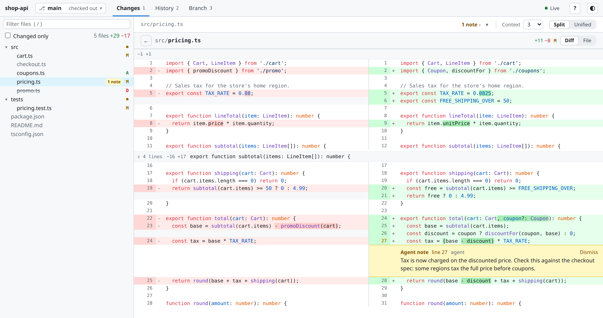

# revue

A git change viewer that runs in your browser. Run `revue` in a repo, and a page opens with your uncommitted changes, any commit, or a branch compared with its base, as split or unified diffs alongside the full file tree. It updates live as you edit.

Use it to read over your work before you commit, to review a branch the way you would a pull request without pushing it anywhere, or to see what a coding agent changed: agents can drive revue over [MCP](#use-it-from-a-coding-agent-mcp) to open the changes, point you at specific lines and leave notes on them.

It's a single binary that needs only git. The UI is built in, and the server listens on 127.0.0.1 only.

<picture>
  <source media="(prefers-color-scheme: dark)" srcset="docs/screenshot-dark.png">
  
</picture>

## Install

revue needs git. Each [release](https://github.com/jmsheas3/revue/releases) has a binary for each platform, packed with this README, revue's license and those of the libraries and Rust crates it's built from:

- **macOS** (Apple Silicon and Intel, one universal binary): open `revue-v<version>-macos-universal.pkg`, which installs `revue` in `/usr/local/bin`, or unpack `revue-v<version>-macos-universal.tar.gz` and put `revue` anywhere on your `PATH`. Both are signed and notarized by Apple. To uninstall the `.pkg`: `sudo rm /usr/local/bin/revue && sudo pkgutil --forget io.github.jmsheas3.revue`.
- **Linux** (x86_64 or ARM64): unpack `revue-v<version>-linux-x86_64.tar.gz` or `revue-v<version>-linux-arm64.tar.gz` and put `revue` on your `PATH`. It's a static binary, so it runs on any distribution.
- **Windows** (x86_64), experimental: unzip `revue-v<version>-windows-x86_64.zip` and run `revue.exe`.

`SHA256SUMS` in each release lists every file's SHA-256: `sha256sum -c SHA256SUMS --ignore-missing` checks the files you downloaded, and on macOS `shasum -a 256 <file>` prints one to compare.

### From source

You need Rust 1.88 or later to build revue:

```sh
cargo install --locked --git https://github.com/jmsheas3/revue
```

That puts `revue` in `~/.cargo/bin`. `--locked` builds it with the dependency versions it's tested with (`Cargo.lock`); without it, cargo picks the newest ones, which may need a newer Rust. From a clone, `cargo install --locked --path .` does the same, and `cargo uninstall revue` removes it. An unrelated crate on crates.io is also called `revue`, so `cargo install revue` installs something else.

revue is tested on Linux and macOS. On Windows, CI checks that it builds, starts and serves a repo, but most of its tests don't run there yet. The page needs a browser from 2024 or later (Chrome or Edge 123, Firefox 121, Safari 17.5); it's tested in Chromium and Firefox, not Safari.

## Quick start

```sh
revue                 # in a git repo: starts a server and opens the browser
revue ~/code/proj     # point it at a repo (any folder inside one works)
revue ~/notes         # a folder that isn't in a repo opens as a plain folder
```

The page opens on your uncommitted changes: every changed file's diff, one after another, next to the file tree. Click a file, or press `j`/`k`, to see one on its own; `Esc` goes back to all of them. `1` `2` `3` switch modes, and `?` lists every shortcut.

revue prints the page's address and listens on port 4777, or on a free port if that one is taken; Ctrl+C stops it. See [Options](#options) for the rest, and [Plain folders](#plain-folders) for folders outside a repo.

## Features

- **Three modes.** **Changes** shows uncommitted work compared with HEAD: staged, unstaged and untracked changes together, one diff per file. **History** lists the branch's commits (or every branch's) and shows each one's diff, a merge's against its first parent. **Branch** compares a branch with its base from their merge-base, like a pull request. The base is the first of `main`, `master`, `origin/main`, `origin/master` and `develop` that exists, and **compared with** picks another.
- **Any branch, without checking it out.** The branch picker in the header shows any local or remote branch. History and Branch follow it; picking one in Changes switches to Branch, since uncommitted work exists only on the checked-out branch. While the picker shows another branch, a **Check out** button runs a real `git switch` after you confirm (see [security](#what-revue-changes-and-security)).
- **The whole file tree**, with changed files marked M, A, D, R, T or U (modified, added, deleted, renamed, type changed, such as a file turned into a symlink, and untracked) and a dot on folders that contain changes. **Changed only** hides the rest.
- **Diffs**, split or unified, with syntax highlighting and the changed part of each line marked. Context can be 3, 10 or 50 lines, or the whole file. The **File** tab shows the whole file with its changed lines marked in the gutter, before or after the change.
- **Images.** PNG, JPEG, GIF, WebP and ICO files are shown as pictures: a changed image before and after, side by side, in its diff and in the overview, and the File tab shows either side. SVG files keep their text views and get an **Image** tab that draws them (an unchanged one opens there). revue tells an image by its contents, not its name (an SVG needs its `.svg` name as well). It doesn't draw these, and says why instead:
  - an image over 20 MB or 50 million pixels;
  - an SVG over 2 MB, one that would draw over 50,000 elements (counting the copies its `<use>`s make), or one that embeds images (as `data:` URLs) that revue can't check or that come to over 50 million pixels in all;
  - an SVG that isn't well-formed XML, which browsers don't draw at all. Its Image tab says what is wrong and on which line, such as `</h> doesn't close <g> (line 3)` or an `xlink:href` without its `xmlns:xlink`. Only what both Chromium and Firefox refuse to draw counts as broken.
- **Go to definition.** Ctrl+click (⌘+click on macOS) a function, class or variable in a diff or file to jump to where it's defined, at the revision you're viewing; browser Back returns you. When several definitions share the name, it follows the file's imports (JS/TS, Python, Go packages, Rust `use` paths and workspace crates) and the call site (`this.`/`self.`, `Type::`, the enclosing class or `impl`, local shadowing) to pick one, and opens a picker only when that still leaves a tie. It's a `git grep` and regex heuristic for JS/TS, Python, Go, Rust, C-family languages and shell, with a looser fallback for other languages, so it's quick but not compiler-accurate.
- **Markdown preview.** `.md` and `.markdown` files have a Preview view (GitHub-flavoured, with `marked`), and an unchanged one opens there. The output is sanitized with DOMPurify. The repo's own images are shown, from the version you're viewing, and `<picture>` sources and GitHub's `#gh-dark-mode-only` / `#gh-light-mode-only` images follow revue's theme; an image from anywhere else is never loaded, and a remote one is a link to it instead. Relative links open the file in revue, and outside links open in a new tab.
- **Live updates.** A file watcher pushes changes to the page as you edit, commit or switch branches. The **Live** dot in the header says whether updates are connected; hover over it for the server's version, port, uptime and open tabs.
- **Agent notes.** Notes a coding agent leaves (see [MCP](#use-it-from-a-coding-agent-mcp)) appear under the lines they're about, in diffs and in the file view, and are marked *outdated* when those lines change afterwards. Each one has a **Dismiss** button. The toolbar counts them, steps through them, opens those left in other views (another commit, say) and clears this view's, and the file tree counts them per file.
- **Light and dark themes.** Auto follows your system, or pick Light or Dark in the header. Narrow windows (760 px or less) get a one-row header and the sidebar as a drawer (☰).

## Keyboard shortcuts

| Keys | What they do |
|---|---|
| `j` `k` (or `n` `p`) | Next / previous changed file |
| `Esc` | Back to all changes |
| `/` | Filter files |
| Ctrl+click (⌘+click) | Go to definition (browser Back returns) |
| `f` | Diff → file → preview (markdown) or image (SVG) |
| `s` | Split / unified |
| `w` | Wrap long lines / scroll sideways |
| `1` `2` `3` | Changes / History / Branch |
| `r` | Refresh |
| `?` | Show or hide the shortcut list (also the `?` button in the header) |

Split needs about 60 characters a side: diffs are unified when the pane is narrower than that, and while wrapping is off (`w`).

In the file tree and the commit list, Tab moves into the list and the arrow keys move between rows. Right opens a folder, and Left closes it; on a file or a closed folder, Left moves up to its parent folder. Home and End go to the first and last row, and Enter or Space opens the row.

## Plain folders

A folder that isn't inside a git repo (or any folder, with `--no-git`) opens as a document viewer for its files: there are no modes, branches, commits or diffs, and the header shows the folder's name with a "folder" tag.

- The file tree lists every file, hidden ones and anything under `.git/` included, up to 50,000 files. Past that, it keeps the files nearest the top of the folder (`.git/` last), and a last row says only the first 50,000 are shown.
- The page opens on the folder's README (`README.md`, then `README`, then any `readme.*`, then `index.md`), rendered when it's markdown (`.md` or `.markdown`), or asks you to pick a file when there is none. Opening a folder in the tree (a click, Enter or Space) shows that folder's README too; the arrow keys only open and close folders.
- Files open in the file view (images as pictures), markdown in the preview and SVG drawn in its Image view. Live updates, agent notes, line targets and the narrow-window drawer work as in a repo.
- Keys: `j`/`k` (or `n`/`p`) go to the next/previous file in the tree, `Esc` goes back to the folder's README, `f` switches a markdown or SVG file between the file view and its preview or image, Ctrl+click (⌘+click) goes to a definition among the folder's files, and `w`, `/`, `r` and `?` work as in a repo (`s` and `1` `2` `3` do nothing).
- revue writes nothing into the folder: with [`--notes file`](#options), notes go to revue's data directory (`$XDG_DATA_HOME/revue/notes/`, or `~/.local/share/revue/notes/`; `~/Library/Application Support/revue/notes/` on macOS, `%LOCALAPPDATA%\revue\notes\` on Windows) instead of `.git/revue/notes.json`.

## Use it from a coding agent (MCP)

`revue mcp` runs an [MCP](https://modelcontextprotocol.io) server over stdio, part of the same binary. It lets an agent open revue, point you at specific lines, and leave notes on them. For Claude Code:

```sh
claude mcp add revue -- revue mcp            # this project only (revue on PATH, or give its full path)
claude mcp add -s user revue -- revue mcp    # every project
```

Other MCP clients take the same command. In a client that's configured with JSON, that's usually:

```json
{ "mcpServers": { "revue": { "command": "revue", "args": ["mcp"] } } }
```

Then ask things like *"show me the code changes"*, *"show me the lines you just changed"* or *"leave notes in revue on anything I should double-check"*.

| Tool | What it does |
|---|---|
| `revue_open` | Open the overview of all changes |
| `revue_show` | Show a file, optionally scrolled to a line or range (`line`, `endLine`), in the diff or whole-file view, or (`view: preview`, without a line) a markdown file rendered or an SVG drawn |
| `revue_annotate` | Leave a note on a line or range, and show it |
| `revue_annotations` | List or clear notes |
| `revue_changes` | Changed files with status and line counts, as text |
| `revue_diff` | Unified diff of one file or all changed files, as text |
| `revue_log` | Recent commits |
| `revue_definitions` | Where an identifier is defined (the same search as Ctrl+click) |
| `revue_status` | Running revue servers and their open tabs |
| `revue_stop` | Stop a server the MCP started |

Every view-dependent tool takes the same `mode` (`working`, `commit` or `branch`) and `ref`/`base`/`head` arguments as the page. A `repo` argument picks the repository (any folder inside it). Without it, tools use the folder `revue mcp` was started in. Claude Code starts it in your project, but a client that starts it somewhere else, such as your home folder, should pass `repo`, or that folder opens as a plain folder. `revue_open`, `revue_show` and `revue_annotate` take `newTab: true` to open a new tab even when one is open. A folder outside any repo, or any folder with `git: false`, opens as a plain folder: `revue_open`, `revue_show`, the notes tools and `revue_definitions` work on its files, and `revue_changes`, `revue_diff` and `revue_log` say it isn't a git repository. A repo's server and a `git: false` server on the same folder are separate servers.

How it behaves:

- **One server per repo.** The MCP server reuses a revue server that's already running for the repo, including one you started yourself with `revue`. Otherwise it starts one, on any free port rather than 4777. Running servers register themselves in `$XDG_RUNTIME_DIR/revue/` (or a per-user temp directory) so they can be found.
- **Your open tab follows.** If a revue tab is open, it moves to what the agent wants to show you. Back returns to where you were. With several tabs open, only the one you used last moves. If no tab is open, a new one opens. A background tab updates but can't bring itself to the front.
- **Server lifetime.** By default, a server the MCP starts stops when the agent session ends. With `revue mcp --lifetime detached` (or `persist: true` on a tool call), it keeps running and exits after 60 minutes with no open tabs and no requests. `revue_stop` stops it sooner. Servers you started by hand are never stopped by the agent.
- **Note storage.** Notes are kept in memory and lost when the server stops. With `--notes file` (on `revue mcp` or `revue`), they're saved per worktree in `.git/revue/notes.json` (a linked worktree's in its own git directory), which git never commits; for a plain folder, they go to revue's data directory (see [Plain folders](#plain-folders)). On `revue mcp` it applies to the servers it starts: a server you started yourself keeps its own setting.

To pass options with Claude Code, put them after `mcp`: `claude mcp add revue -- revue mcp --notes file`.

## Options

```sh
revue [dir] [--port N] [--no-open] [--no-git] [--notes memory|file] [--idle-timeout MIN]
revue mcp [--lifetime session|detached] [--notes memory|file] [--idle-timeout MIN]
```

| Option | Environment variable | Default | What it does |
|---|---|---|---|
| `dir` | | the current directory | The repo (any folder inside it) or plain folder to open |
| `--port N` | | 4777, or a free port if that one is taken | The port to listen on. An explicit port that's in use is an error, and `0` picks any free port. |
| `--no-open` | | | Don't open the browser |
| `--no-git` | | | Open `dir` as a plain folder, even inside a repo |
| `--notes memory\|file` | `REVUE_NOTES` | `memory` | Where agent notes are kept (see Note storage above) |
| `--idle-timeout MIN` | `REVUE_IDLE_TIMEOUT` | never (60 for detached servers) | Exit after MIN minutes with no open tabs and no requests. On `revue mcp`, it sets the timeout of detached servers only; servers that live with the session stop when it ends. |
| `--lifetime session\|detached` | `REVUE_LIFETIME` | `session` | `revue mcp` only: whether the servers it starts stop with the agent session or keep running |
| `-V`, `--version` | | | Print the version and the commit it was built from |
| `-h`, `--help` | | | Print the usage |

## What revue changes, and security

- **It reads your repo; it changes your files only when you check out a branch.** **Check out** runs `git switch` after you confirm. It refuses while tracked files have uncommitted changes, and a remote-only branch gets a local tracking branch.
- **Two other writes stay inside `.git/`.** The Changes view refreshes the index's cached file timestamps (`git update-index --refresh`, as `git status` does) so diffs stay fast, and with `--notes file`, agent notes are saved in `.git/revue/notes.json`. In a plain folder, nothing is written into the folder at all.
- **Only your machine can reach it.** The server listens on 127.0.0.1 and answers only requests addressed to `127.0.0.1:<port>` or `localhost:<port>`, so a website can't read your code through it with DNS rebinding. Nor can a page on another site, or one served by another server on your machine, use it: before doing any work, the API refuses every request the browser marks as sent by another page (`Sec-Fetch-Site`), and every answer is marked for revue's own page only (`Cross-Origin-Resource-Policy`). Requests that check out a branch, move your tab, or add or clear notes must be POSTs carrying a header that a cross-site request can't send. Other users logged in to the same machine can reach it too, as they can any server on 127.0.0.1, so on a shared machine they could read what revue shows you.
- **Repo content is treated as untrusted.**
  - Paths and refs from the page are checked so nothing outside the repo is read, and symlinks that lead out of it aren't followed.
  - The markdown preview is sanitized and loads nothing but the repo's own images, through revue, and the page runs under a strict Content Security Policy.
  - Images are served only as images, and sandboxed when opened in a tab of their own. An SVG, which can hold script, is drawn only as an image, where browsers run none of it, and opening one on its own downloads it.
  - An image whose header claims more than 50 million pixels is refused rather than handed to your browser to decode. So is an SVG that would draw more than 50,000 elements: a `<use>` draws a copy of a group that can hold more of them, so a file of a kilobyte can draw millions and freeze the tab. Images an SVG embeds as `data:` URLs, which an image does load, are held to the same limits, all of them together, and one revue can't check is refused.
  - An SVG within every limit can still be slow to draw: filters (a large blur, say), patterns and markers take time without adding elements, and nothing measures that short of drawing it. Such a file can hold its tab for a while; closing the tab recovers.

## Development

The server is in `src/` (`server.rs` for the HTTP API, `image.rs` for what counts as an image, `definitions.rs` for go to definition, `mcp.rs` for the MCP server) and the UI is in `public/`: plain JavaScript with no build step, embedded in the binary at build time, so a change there needs a rebuild. Plain git reads (refs, trees, blobs, history) happen in process through [gitoxide](https://github.com/GitoxideLabs/gitoxide); diffs and grep come from the git CLI, so they match git exactly.

```sh
cargo run -- --no-open    # run against this repo without opening a browser
cargo test                # builds the binary and runs the API, live-update and go-to-definition tests against it
cd ui-tests
npm ci && npm run install-browsers   # once
npm test                  # browser tests (Playwright, Chromium and Firefox)
npm run screenshots       # retake the screenshots above (docs/screenshot-*.png)
```

### Pull requests and releases

Work goes into `develop` through pull requests, and `develop` goes into `main`. Every pull request into either runs the checks in [`.github/workflows/ci.yml`](.github/workflows/ci.yml): `cargo test` on Linux (x86_64 and ARM64) and macOS, the browser tests, clippy for the Linux, macOS and Windows code, a build with the oldest Rust revue supports, `cargo audit`, a check that every crate's license is one [`.github/licenses/about.toml`](.github/licenses/about.toml) accepts, a Windows build that has to start and serve a repo, and a check of the version in `Cargo.toml`. The one check both branches require, **CI passed**, passes only when all of those did. Only `develop` and `hotfix/…` branches can merge into `main`. The full `cargo test` also runs on Windows, without blocking anything, to show what still fails there.

To release:

1. Raise `version` in `Cargo.toml`, run `cargo check` so `Cargo.lock` follows, and merge that into `develop`.
2. Open a pull request from `develop` into `main`, and merge it with **Create a merge commit**.

The merge to `main` runs every check again on the merged commit, builds the binaries, signs and notarizes the macOS ones, tests the installer on an Apple Silicon and an Intel Mac, and publishes everything as the release `v<version>`, which tags that commit. A release can't be changed afterwards, and its version can't be used again. A merge to `main` that doesn't raise the version builds the binaries (kept with the workflow run for 90 days) and releases nothing. `cargo audit` also runs every Monday on both branches, and Dependabot updates the workflows' Actions once a month.

## License

MIT; see [LICENSE](LICENSE). The UI includes highlight.js (BSD-3-Clause), marked (MIT) and DOMPurify (Apache-2.0 or MPL-2.0), unmodified in `public/vendor/`; their license texts are in [THIRD_PARTY_LICENSES](THIRD_PARTY_LICENSES). The binaries are also built from Rust crates under their own licenses (MIT, Apache-2.0 and a few others); each release lists them, with their license texts, in `THIRD_PARTY_LICENSES_RUST`.
